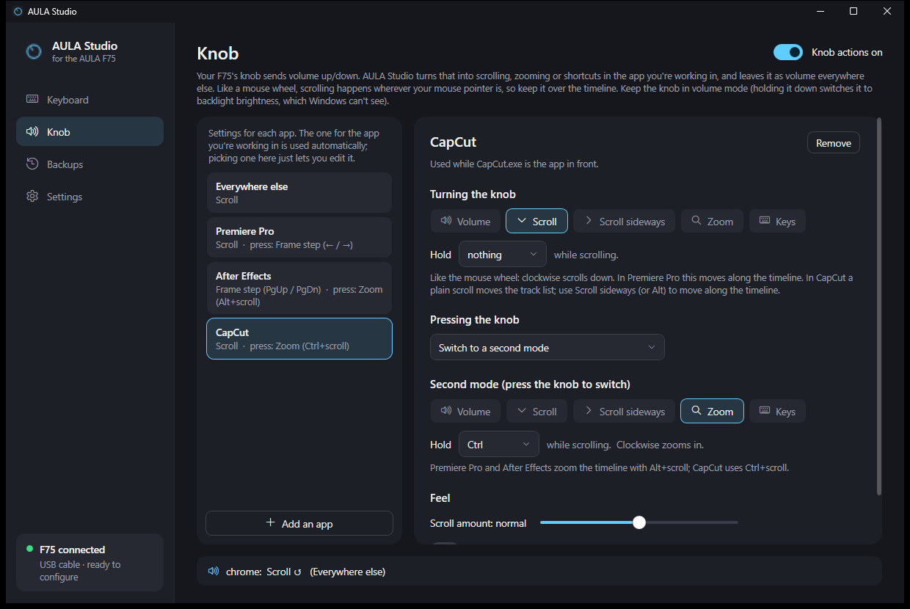
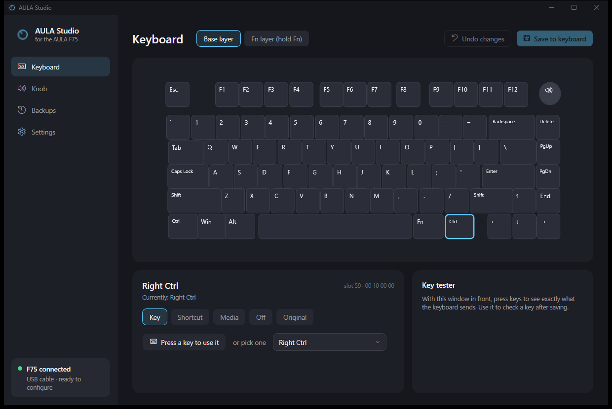
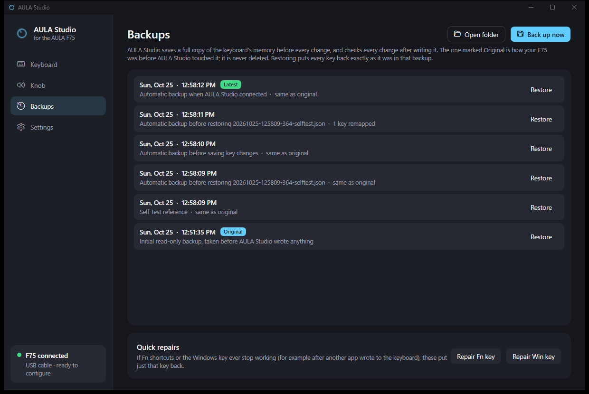
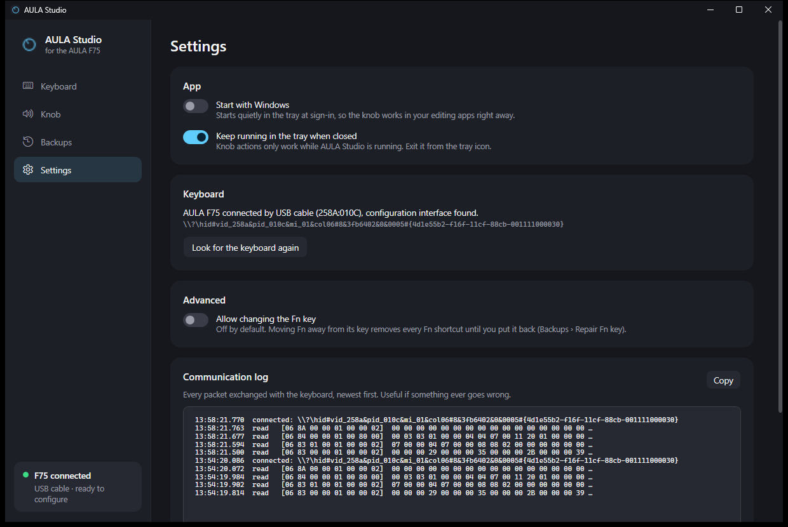

# AULA Studio

A Windows app for the **AULA F75** keyboard. It does three things:

- **Remaps keys inside the keyboard itself.**
- **Makes the volume knob useful for video editing.** Per app, it can scroll, scroll sideways, zoom, or step through frames.
- **Backs up the keyboard's memory before every change.**



> AULA Studio is an independent project. It isn't made or endorsed by AULA. It was built for, and tested on, a wired AULA F75 (USB `258A:010C`) on Windows 11.

## Contents

- [Features](#features)
- [Requirements](#requirements)
- [Getting started](#getting-started)
- [Using AULA Studio](#using-aula-studio)
- [How the knob works](#how-the-knob-works)
- [Safety](#safety)
- [Troubleshooting](#troubleshooting)
- [Files and command-line options](#files-and-command-line-options)
- [Building from source](#building-from-source)
- [Project layout](#project-layout)
- [Further documentation](#further-documentation)
- [Known limitations](#known-limitations)
- [Credits](#credits)

## Features

### Key remapping, saved in the keyboard

- **Any key can be changed.** Click a key on the picture of the F75, then pick what it should do:
  - another key;
  - a shortcut, such as Ctrl+Shift+Z;
  - a media key;
  - nothing at all.
- **Both layers.** You can edit the base layer and the Fn layer (what keys do while Fn is held).
- **Changes live in the keyboard's own memory,** so they work on any PC, with or without AULA Studio running.
- **Nothing is written until you click Save to keyboard.** Pending changes are highlighted and can be undone.
- **A key tester** shows exactly what the keyboard sends.

### The knob, for editing

The F75's firmware hard-wires the knob's rotation to volume. AULA Studio intercepts it and does something else, depending on the app in front:

| App | Turning the knob | Pressing the knob switches to |
|---|---|---|
| Premiere Pro | Scroll (moves along the timeline) | Frame step (← / →) |
| After Effects | Frame step (Page Up / Page Down) | Zoom (Alt+scroll) |
| CapCut | Scroll sideways (moves along the timeline) | Zoom (Ctrl+scroll) |
| Everything else | Volume, as before | — |

- **Five modes:**
  - **Volume**.
  - **Scroll**.
  - **Scroll sideways**.
  - **Zoom**, using Ctrl, Alt or Shift + scroll.
  - **Keys**: presets (frame step, jump between edits, zoom with = / -, redo / undo), or any key or shortcut.
- **Hold a key while scrolling.** Scroll modes can hold Ctrl, Alt or Shift, e.g. Alt+scroll.
- **Pressing the knob** can mute, play/pause, or switch to a second mode. A small on-screen label shows the new mode.
- **Feel settings:**
  - scroll amount;
  - reverse direction;
  - "go further when turning fast", up to 3× when you spin the knob quickly.
- **Any app can get its own rule.** Rules follow the app in front automatically.
- **Tray › Knob mode** sets one mode for every app with one click. **Automatic (per app)** goes back to the per-app rules.

### Backups and safety

- **The Original backup.** The first time AULA Studio connects, it saves a copy of the keyboard's memory, read-only. This backup is marked **Original** and is never deleted.
- **A backup before every change.** Every write is read back and compared byte for byte. On any mismatch, the previous contents are written back automatically.
- **Backups › Restore** puts every key back from any backup.
- **Repair Fn key** and **Repair Win key** fix just those keys.

### Tray app

- **It lives in the tray,** because knob actions only work while it's running.
- **It can start with Windows.**
- **The whole interface is dark,** including the tray menu.

## Requirements

- Windows 10 or 11, 64-bit.
- The [.NET 10 Desktop Runtime](https://dotnet.microsoft.com/download/dotnet/10.0) (x64).
- An AULA F75.
  - **Key remapping needs the USB cable.** The 2.4 GHz receiver uses a different protocol.
  - The knob was tested over the cable.

## Getting started

1. Build `AulaStudio.exe` (see [Building from source](#building-from-source)) and put it in a folder of its own.
2. Plug the F75 in with its USB cable. If AULA's own app (`OemDrv.exe`) is open, close it.
3. Run `AulaStudio.exe`. It finds the keyboard, takes the **Original** backup, and shows **F75 connected** at the bottom left.
4. Optional: turn on **Settings › Start with Windows** so the knob works as soon as you sign in.

## Using AULA Studio

### Keyboard



- Choose **Base layer** or **Fn layer (hold Fn)**, then click a key. The editor below has five options:

  | Option | What the key does |
  |---|---|
  | **Key** | Another key. Press the key you want, or pick it from the list. |
  | **Shortcut** | A whole shortcut. Tick Ctrl / Shift / Alt / Win and choose a key; the keyboard sends the shortcut from one key. |
  | **Media** | A media key: play/pause, next, volume, and so on. |
  | **Off** | Nothing at all. |
  | **Original** | Whatever it did in the Original backup. |

- Edited keys are highlighted. **Save to keyboard** writes them all at once; **Undo changes** throws them away.
- The Fn key and the knob press are locked. To unlock them, turn on **Settings › Advanced › Allow changing the Fn key**.
- **Key tester:** with AULA Studio in front, press keys to see what the keyboard sends. Keys typed in other apps never show up here.

### Knob

- **One rule per app.** The list on the left has one rule per app.
  - The rule for the app in front is used automatically.
  - Selecting a rule in the list only opens it for editing.
- **Turning the knob:** the mode. For scroll modes, also a key to hold while scrolling.
- **Pressing the knob:** Mute, Play / Pause, or Switch to a second mode. The second mode has its own settings below.
- **Feel:** scroll amount, reverse direction, and go further when turning fast.
- **Add an app** lists the apps that are open right now.
- **The bottom line shows every knob turn,** with the app it detected and what it did.
- **Scrolling goes wherever the mouse pointer is,** like a real wheel, so keep the pointer over the timeline.

### Backups



- **The list.** Every backup, newest first, with what changed compared with the Original.
  - **Restore** writes that backup back, after taking one more backup of the current state.
- **Back up now** and **Open folder** are at the top.
- **Quick repairs** put the Fn key or the Windows key back on their own, e.g. if another app wrote to the keyboard.

### Settings



- **Start with Windows:** starts hidden in the tray at sign-in.
- **Keep running in the tray when closed.**
- **Keyboard:**
  - how the keyboard is connected;
  - its configuration interface;
  - **Look for the keyboard again**.
- **Advanced:** allows changing the Fn key and the knob press.
- **Communication log:** every packet exchanged with the keyboard, newest first.

### Tray menu

- **Left-click** opens AULA Studio.
- **Right-click** shows:
  - **Knob mode**: Automatic (per app), or one mode for every app;
  - **Knob actions** on/off;
  - **Start with Windows**;
  - **Exit**.

## How the knob works

The knob isn't in the keyboard's key table. Turning it makes the keyboard send Volume Up/Down through its *consumer-control* HID collection, and Windows turns those into volume keys itself. AULA Studio uses two routes:

- **The keyboard hook (main route).** A low-level keyboard hook catches the volume keys and swallows them, so the volume doesn't change. Then AULA Studio does the action set for the app in front.
- **Raw Input (backup route).** AULA Studio also reads the knob's HID reports directly. Both copies of each click are paired, so every click is handled exactly once.

Getting this right was the hard part. Windows marks the knob's volume keys as *injected* (made by software, not by a keyboard driver). An earlier version ignored all injected keys, so it never saw the knob, and Windows kept changing the volume. The investigation and the fix are written up in [docs/knob-detection.md](docs/knob-detection.md).

## Safety

These rules are enforced in code, not just in the interface:

- **Backup first, verify after.** Every write follows the same routine:
  1. fresh read;
  2. refuse unsafe changes;
  3. backup;
  4. write;
  5. read back;
  6. automatic rollback on any mismatch.
- **One write command only.** The only command ever sent is the key table write (`0x03`). Lighting, macro, reset and firmware commands are never sent.
- **Locked slots.**
  - Fn (slot 53) and the knob press (slot 84) can only change with Settings › Advanced on.
  - The key table's trailer (slot 127) can never change.
  - Fn must stay on its key unless Advanced is on.
- **Fn layer first, base layer last.** Normal typing ends up correct whatever happens to the Fn layer.
- **One writer at a time.** Writes are refused while AULA's own app (`OemDrv.exe`) is running, because both apps write the same memory.
- **Cable only for configuration.** The 2.4 GHz receiver gets a "plug in the cable" message.
- **Self-test.** `AulaStudio.exe --selftest` proves the backup/restore cycle on the real keyboard:
  1. rewrites identical data;
  2. remaps Right Ctrl → F13;
  3. restores the backup;
  4. checks every byte.

## Troubleshooting

| Problem | What to do |
|---|---|
| The knob still changes the volume | Check that AULA Studio is running (tray icon) and that **Knob actions** is on. The bottom line of the Knob page shows which app and rule each turn used, and `knob.log` has the details. |
| The knob scrolls, but CapCut's timeline doesn't move | In CapCut, a plain scroll only moves the track list up and down. Use **Scroll sideways** (or hold Alt) to move along the timeline. |
| The knob does nothing in one app | If that app runs as administrator, Windows blocks input from normal apps. Run AULA Studio as administrator too. |
| The knob changes the backlight instead of the volume | Holding the knob down switches it to backlight brightness, which Windows can't see. Hold it down again to switch back. |
| "AULA's own app is open" | Close AULA's app (check the tray too), then save again. |
| "Plug in the USB cable" | The 2.4 GHz receiver can't be used for configuration. Connect the cable. |
| Fn shortcuts or the Windows key stopped working | Use **Backups › Repair Fn key** / **Repair Win key**, or restore a backup. |

## Files and command-line options

| What | Where |
|---|---|
| Settings | `%APPDATA%\AulaStudio\settings.json` |
| Backups | `%APPDATA%\AulaStudio\backups\*.json`: raw hex of both key layers, the lighting block and the color table |
| Knob log | `%APPDATA%\AulaStudio\knob.log`: volume/mute keys and knob clicks only, never other keys |
| Errors | `%APPDATA%\AulaStudio\error.log` |
| Self-test results | `%APPDATA%\AulaStudio\selftest.log` |

| Option | What it does |
|---|---|
| `--tray` | Start hidden in the tray (used by Start with Windows) |
| `--exit` | Quit a running copy cleanly |
| `--dump` | Read-only check of the keyboard, written to `selftest.log` |
| `--selftest` | The backup/restore proof described under [Safety](#safety) |
| `--knobtest` | Checks the volume fallback against Windows: sends a volume key, checks it's undone, and leaves the volume where it was |

Running `AulaStudio.exe` while it's already running just brings the open copy to the front.

## Building from source

You need the [.NET 10 SDK](https://dotnet.microsoft.com/download/dotnet/10.0).

```
dotnet publish -c Release -r win-x64 -p:SelfContained=false -p:PublishSingleFile=true -o publish
```

- **The output** is `publish\AulaStudio.exe`, a single file of about 0.4 MB that uses the installed .NET Desktop Runtime.
- **Pass `-p:SelfContained=false` exactly as shown.** With `--self-contained false`, this project came out as a 165 MB self-contained file.
- **Exit a running copy first** (`publish\AulaStudio.exe --exit`), otherwise publishing can't replace the exe.
- **There are no NuGet packages.** HID access, the keyboard hook, Raw Input and Core Audio all go through P/Invoke and COM interop.

## Project layout

```
AulaStudio/
├─ App.xaml(.cs)          startup, single instance, command-line options
├─ MainWindow.xaml(.cs)   window shell: navigation, connection status, dark title bar
├─ Services.cs            the long-lived services; Start with Windows
├─ SelfTest.cs            --dump and --selftest
├─ Theme.xaml             colors and control styles
├─ Device/                HID access and the safe write routine
├─ Protocol/              key table format, HID usage names
├─ Layout/                key positions on the F75
├─ Backup/                backup files
├─ Input/                 keyboard hook, Raw Input, input injection
├─ Knob/                  knob engine, volume guard, on-screen label, knob log, --knobtest
├─ Settings/              settings and knob presets
├─ Tray/                  tray icon and menu
├─ Views/                 the Keyboard, Knob, Backups and Settings pages
└─ docs/                  documentation and screenshots
```

## Further documentation

- [docs/knob-detection.md](docs/knob-detection.md): why the knob kept changing the volume, and how it was fixed.
- [docs/protocol.md](docs/protocol.md): the F75's configuration protocol, as verified on real hardware.
- [docs/architecture.md](docs/architecture.md): how the app is put together.

## Known limitations

- **No lighting or macros yet.** Keep using AULA's app for lighting, and close it before saving key changes here.
- **Configuration needs the USB cable.** The 2.4 GHz receiver and Bluetooth aren't supported for configuration.
- **The knob press is expected to arrive as Mute.** This hasn't been confirmed on hardware yet.
- **Tested on one keyboard only:** a wired F75 (`258A:010C`) on Windows 11.

## Credits

The F75's protocol was reverse-engineered by others:

- [open-aula](https://github.com/paulcoding810/open-aula) by paulcoding810;
- [openaula](https://github.com/not-ayan/openaula) by not-ayan (MIT).

AULA Studio is a separate implementation. Where their notes and the keyboard disagreed (which byte of a key slot holds the key), it follows what the keyboard itself reported.
